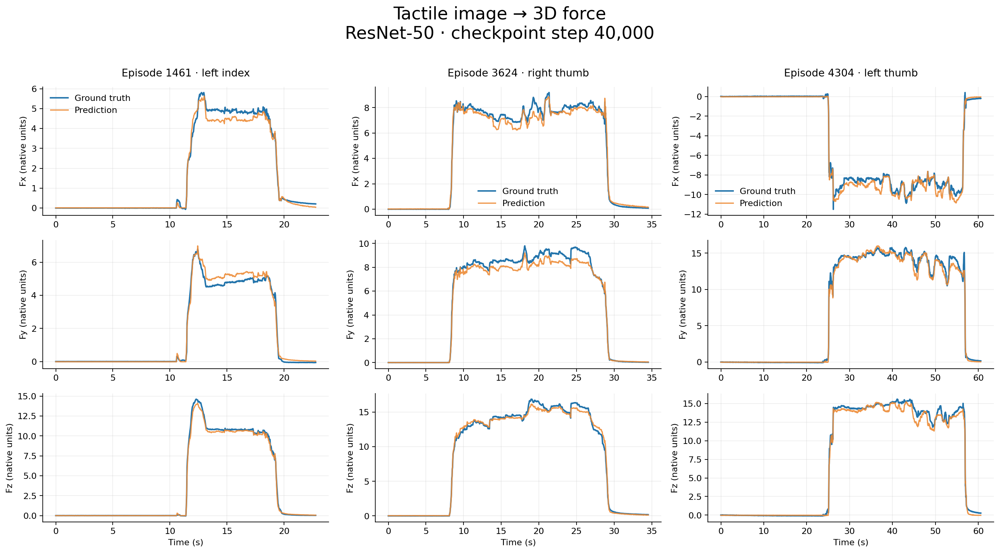

# Sharpa Force Predict

仅用一张原始触觉图像，回归该手指的三维力值 Fx、Fy、Fz。基于 T-Rex 数据集，十个手指共享一个 ResNet-50 模型，不输入 RGB 视频、形变图、手指 ID 或历史力值。

蓝线为真实值，橙线为预测值；横轴为时间，曲线保留完整序列，不做平滑。

## 完整测试结果

使用第 40,000 step 的 checkpoint，测试集包含 546 个独立 episode、十个手指，共 5,602,300 个图像–力值样本。

| 指标 | Fx | Fy | Fz |
|---|---:|---:|---:|
| MAE | 0.1800 | 0.1884 | 0.2226 |
| RMSE | 0.4537 | 0.4890 | 0.5559 |
| R² | 0.9341 | 0.9552 | 0.9712 |

三维力向量平均欧氏误差为 **0.3923**。使用数据集原始单位，未独立验证牛顿单位标定。按 episode 划分训练、验证、测试集，物体可跨集合重复；本结果不代表未知物体泛化性能。测试样本中约 69.68% 为近零力，非近零力子集的平均向量误差为 1.0806。

## 使用

完整安装、下载、训练、断点续训、评估和单图推理指令见 [English README](README.md)。`--batch-size` 指全局 batch；两卡 batch 1024 对应每卡 512。报告配置为 FP32、无激活重计算、每 5000 step 保存 checkpoint，每 epoch 验证后再保存一次。中途恢复会保留数据游标，不重复已训练的 batch。

训练代码、测试代码、完整聚合指标、逐 episode / 逐手指指标、展示曲线及其数值数据均已提供。原始数据集和大型 checkpoint 不随 Git 仓库分发。20 epoch 是原训练计划，当前报告只评估第 40,000 step，并非训练满 20 epoch 的最终结果。

[详细评估报告](results/step40000/REPORT.md) · [逐手指指标](results/step40000/metrics_by_finger.csv)

代码采用 MIT 协议，数据集遵循原作者授权。本仓库是独立实验实现，不是 Sharpa 或 T-Rex 官方项目。
