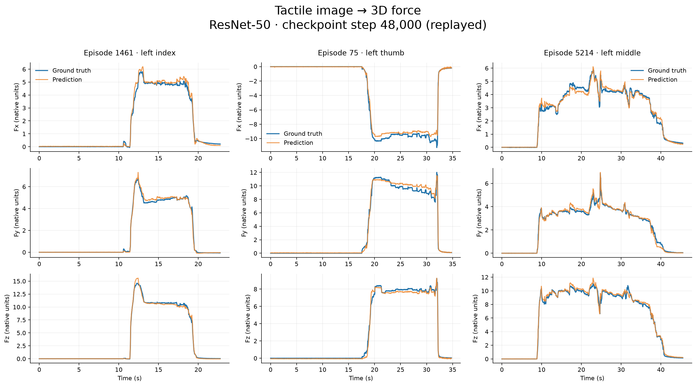

# Sharpa Force Predict

仅用一张原始触觉图像，回归该手指的三维力值 Fx、Fy、Fz。基于 T-Rex 数据集，十个手指共享一个 ResNet-50 模型，不输入 RGB 视频、形变图、手指 ID 或历史力值。

**技术博客：[只看一张触觉图像，能估计多大的力？一次十指共享模型的完整实验](docs/blog/2026-10-27-tactile-image-to-force.md)**

蓝线为真实值，橙线为预测值；横轴为时间，曲线保留完整序列，不做平滑。

## 完整测试结果

使用第 48,000 step（重放得到）的 checkpoint，测试集包含 546 个独立 episode、十个手指，共 5,602,300 个图像–力值样本。

| 指标 | Fx | Fy | Fz |
|---|---:|---:|---:|
| MAE | 0.1832 | 0.1778 | 0.2103 |
| RMSE | 0.4479 | 0.4587 | 0.5451 |
| R² | 0.9358 | 0.9606 | 0.9723 |

三维力向量平均欧氏误差为 **0.3802**。使用数据集原始单位，未独立验证牛顿单位标定。按 episode 划分训练、验证、测试集，物体可跨集合重复；本结果不代表未知物体泛化性能。测试样本中约 69.68% 为近零力，非近零力子集的平均向量误差为 1.0437。

## 与 40,000 step 的比较

两次使用相同 manifest、相同独立测试集。三维力向量平均误差从 **0.392341 降至 0.380168，下降 3.10%**；Fy / Fz 的 MAE 分别下降 5.63% / 5.52%，Fx 的 MAE 上升 1.78%。三个方向的 RMSE 均下降，但向量误差中位数上升，改善并非覆盖每个样本和每根手指。近零力、非近零力和大力值子集的平均向量误差分别为 0.091471、1.043660、1.835481。

原运行没有保存 48,000 step 权重，因此本次从 45,000 step 的完整断点恢复，在单卡上重放至 48,000 step，再进行完整测试推理。保留全局 batch 1024，以两次 microbatch 512 累积梯度；数据游标和采样配置恢复，FP32、无激活重计算。CUDA 运算不保证与已丢弃的原运行逐位相同。

[完整对比及所有手指结果](results/step48000/REPORT.md) · [保留的 40,000 step 结果](results/step40000/REPORT.md)

## 使用

完整安装、下载、训练、断点续训、评估和单图推理指令见 [English README](README.md)。`--batch-size` 指全局 batch；两卡 batch 1024 对应每卡 512。重放使用单卡两次 microbatch 512，测试使用单卡 batch 512。报告配置为 FP32、无激活重计算、每 5000 step 保存 checkpoint，每 epoch 验证后再保存一次。中途恢复会保留数据游标，不重复已训练的 batch。

训练代码、测试代码、完整聚合指标、逐 episode / 逐手指指标、展示曲线及其数值数据均已提供。原始数据集和大型 checkpoint 不随 Git 仓库分发。20 epoch 是原训练计划，当前报告只评估第 48,000 step（重放得到），并非训练满 20 epoch 的最终结果。

[详细评估报告](results/step48000/REPORT.md) · [逐手指指标](results/step48000/metrics_by_finger.csv)

代码采用 MIT 协议，数据集遵循原作者授权。本仓库是独立实验实现，不是 Sharpa 或 T-Rex 官方项目。
